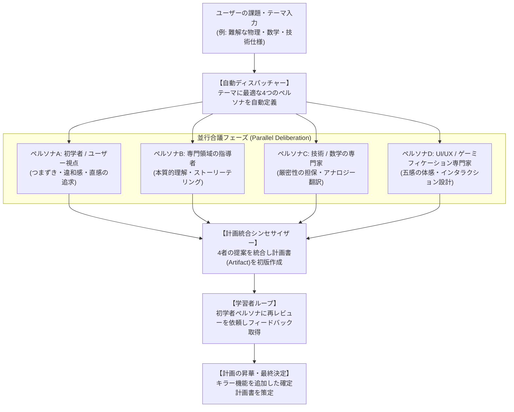

# 【自動化フレームワーク】マルチペルソナ合議＆計画策定プロンプト（Subagent Council Framework）

ユーザーの「この難解なテーマをわかりやすく解説するアプリ・教材を作りたい」という要求に対し、**複数の専門サブエージェント（学習者、専門家、教育者、デザイナー）を自動編成し、合議を経て計画を立案・洗練するメタプロンプトおよび自動化手順書**です。

---

## 1. 自動合議オーケストレーションの全体フロー



---

## 2. コピペで使える「自動化実行プロンプト」（メタプロンプト）

エージェントに対して以下のプロンプトをそのまま送信することで、いつでも自動でサブエージェント合議を起動できます。

```markdown
# 指示：マルチペルソナ合議によるインタラクティブ教材／アプリ計画の自動立案

## 対象テーマ
{{ ここに難解な概念や課題を入力。例：電荷の静電エネルギーと電子の古典半径、量子もつれ、フーリエ変換など }}

## 実行ステップ
1. **専門サブエージェントの自動定義 (define_subagent)**:
   以下の4役を自動で定義してください：
   - `learner-persona`: 対象読者（高校生・初学者）のペルソナ。数式アレルギーやつまずきポイントを率直に指摘する。
   - `domain-educator`: 教育者ペルソナ。直感的な日常の例えと本質的な物理・専門概念を繋ぐ。
   - `math-tech-expert`: 数学/技術ペルソナ。高校レベルと大学/専門レベルのギャップを幾何学的・視覚的に橋渡しする。
   - `ui-ux-specialist`: UI/UX専門家。触って体感できるギミック、ゲーミフィケーション、画面構成を提案する。

2. **並行ブレインストーミング (invoke_subagent)**:
   4つのサブエージェントを同時に起動し、それぞれの専門領域から「つまずき」「キラーメタファー」「UIギミック」「教育展開」を提案させてください。

3. **合議の統合と計画策定 (Plan Artifact)**:
   集まった4者の提案を統合し、対立点を解消した包括的計画書（アーティファクト）を作成してください。

4. **初学者レビュー＆計画リファイン (Feedback Loop)**:
   初学者ペルソナに計画をぶつけ、「まだ難しい点」「もっとワクワクする追加要素」を聞き出し、計画を第2版へブラッシュアップしてください。
```

---

## 3. 自動化スクリプト・ツール連携の実装方針

CLI やスクリプト経由で実行したい場合、以下のように TypeScript / Node.js でラップして API 呼び出しを連動させることができます：

```typescript
// scripts/ai-agent/councilOrchestrator.ts
export async function runSubagentCouncil(topic: string) {
  const personas = [
    { role: 'Student', type: 'student-persona', focus: 'friction points & intuitive analogies' },
    { role: 'Domain Teacher', type: 'domain-teacher', focus: 'pedagogical narrative & core truth' },
    { role: 'Technical Expert', type: 'tech-expert', focus: 'mathematical bridge & accuracy' },
    { role: 'UI/UX Specialist', type: 'ui-ux-specialist', focus: 'interactive simulation & game mechanics' }
  ];

  // 1. Launch in parallel
  const replies = await Promise.all(personas.map(p => invokeSubagent(p.type, topic)));

  // 2. Synthesize Plan
  const plan = synthesizePlan(topic, replies);

  // 3. Challenge with Student Feedback Loop
  const studentFeedback = await sendSubagentMessage('student-persona', plan);

  // 4. Final Refined Plan
  return refinePlan(plan, studentFeedback);
}
```
