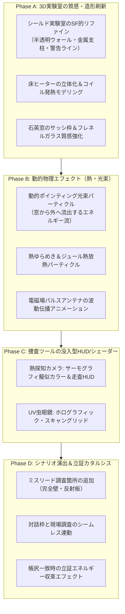

# ミステリー捜査モード グラフィック＆シナリオ改善計画書
## 「密室から消えた 80 ジュールの謎 〜電磁場エネルギー消失事件〜」改善プラン

---

## 1. 概要と検証実施結果

本計画は、物理シミュレーター内の「ミステリー捜査モード（ポインティングの定理 × 密室ミステリーノベル型教材）」のグラフィック品質およびシナリオ演出を抜本的に向上させるための改善方針と実装計画をまとめたものです。

### 1.1 検証の実施状況
新ブランチ `feature/improve-graphics` において、以下のテストおよび自律エージェント検証を実施しました：
1. **Playwright E2E テスト (`e2e/mystery_investigation.spec.ts`)**:
   - 初期表示、消失エネルギー計算、対話ウィンドウ、捜査ツール切替、証拠配置と帳尻合わせ、順不同捜査（石英窓先行）を含む全 6 テストケースが PASS（正常動作を確認）。
2. **AI エージェント自律捜査テスト (`npm run agent:mystery`)**:
   - 初期現場（01）→ 対話（02）→ ツール切替（03）→ 現場証拠発見（04）→ 手帳帳尻合わせ（05）→ 立証解決モーダル（06）→ 解決後俯瞰（07）の全フローを実行し、スクリーンショットおよびレポートを生成・精査。

---

## 2. 現状のシナリオおよびグラフィックの評価

### 2.1 シナリオ面の評価

#### 【優れた点（強み）】
1. **ポインティングの定理の動機づけとしての完成度**:
   - 「100 J あった電磁場が 5 秒で 20 J に減り、80 J が密室から忽然と消えた」という謎解き導入は、数式アレルギーを持つ学習者でも直感的に「帳尻を合わせたい」と感じる強いストーリー推進力がある。
2. **物理概念とミステリー要素の整合性**:
   - 床のヒーター抵抗（$-30\text{ J}$：ジュール熱 $\int_V \boldsymbol{j} \cdot \boldsymbol{E} \, dV$）と、南壁の石英ガラス窓（$-50\text{ J}$：ポインティング流束 $\oint_{\partial V} \boldsymbol{S} \cdot d\boldsymbol{A}$）という物理的内訳が明確で、等式 $\Delta W = -\int \boldsymbol{j}\cdot\boldsymbol{E} dV - \oint \boldsymbol{S}\cdot d\boldsymbol{A}$ に美しく帰着する。
3. **歴史的コンテキストの提供**:
   - 解決モーダルにおいて、ジョン・ヘンリー・ポインティングがなぜこの定理を導いたのか（光がエネルギーの実体を持って流れていることの証明）が解説されており、学習の着地点としてカタルシスがある。

#### 【課題点と改善余地】
1. **探索の深さと「推理体験」の単調さ**:
   - 現在は「怪しい場所が床ヒーターと石英窓の2箇所のみ」であり、クリックすれば即座に正解の証拠が得られるため、探偵としての「観察・比較・推理」の余地がやや薄い。
   - **改善案**: 破壊されていない「完全電磁シールド金属壁」や「給電アンテナのコンデンサ」、反射板などのダミー（ミスリード／調査可能ポイント）を配置し、「ここからはエネルギーは漏れていない＝透過しない」ことを確認する科学的検証プロセスを取り入れる。
2. **対話テキストと3D捜査の同期の硬さ**:
   - 下部のノベルウィンドウの台詞と、3D画面内のオブジェクトクリックによるトースト通知（「重要な証拠を発見！」）が別個に動作しており、助手のアオイや探偵のキャラクターリアクションがクリック時に即座に対話枠へ反映されない。
   - **改善案**: オブジェクト調査時にキャラの動的な吹き出しや表情差分（驚き、ひらめき、納得）をインライン表示し、ゲームブックのような臨場感を高める。
3. **チュートリアル・誘導の自然さ**:
   - どのツール（熱探知カメラ vs 精密虫眼鏡）を使うべきかの誘導がプロンプト頼みになっているため、調査ミス（例: 通常ツールで窓を調べた場合に「肉眼ではただのガラスに見える…UVライトが必要だ」とキャラが示唆する等）の段階的フィードバックが必要。

---

### 2.2 グラフィック面の評価

#### 【優れた点（強み）】
1. Three.js による軽量な 3D 閉領域表現（ワイヤーフレーム枠とグリッド）で、60fps を維持したスムーズな描画。
2. ツール切替（熱探知カメラ、虫眼鏡）に応じてマテリアルのエミッシブカラーや ArrowHelper が切り替わる基礎インタラクションが構築されている。

#### 【課題点と改善余地】

| 項目 | 現状の課題 | 改善目標（あるべき姿） |
| :--- | :--- | :--- |
| **実験室の環境ビジュアル** | 虚空に浮かぶ青いワイヤーキューブとグリッドのみで、最先端の「電磁シールド密閉実験室」に見えない。 | SF・研究施設風の半透明シールドウォール、金属リベット付きフレーム、コーションライン（警戒帯）、床面の高密度サイバーテクスチャを追加。 |
| **ジュール熱（床ヒーター）** | 単なる赤茶色の平面ポリゴン（PlaneGeometry）の上に数本の白線が乗っているだけで、熱源としての実在感が乏しい。 | 埋め込み式サーマルスリット構造、発熱する赤熱コイルフィラメントの立体化、熱のゆらめき（熱気エフェクト・上昇サーマルパーティクル）。 |
| **石英窓とガラス質感** | 単色の半透明シアン板で、ガラスの屈折感や透過感が弱い。 | 強化耐熱ガラスのフレネル反射、金属サッシ枠、コーナーリベット、外部の暗黒空間が透けて見える光学表現。 |
| **ポインティング光束の演出** | 静止したオレンジ色の矢印（ArrowHelper）が壁に突き刺さっているだけで、エネルギーが外部へ流出している勢い・波動性が伝わらない。 | 石英窓から外へ向かって連続的に噴き出す**動的エネルギー光粒子ストリーム（Particle Beam）**、電場 $\boldsymbol{E}$ と磁場 $\boldsymbol{B}$ の直交振動波、光の波動伝播アニメーション。 |
| **捜査ツールの視覚体験** | 「熱探知カメラ」にしても床が赤くなるだけで、サーモグラフィ特有の画面効果がない。「虫眼鏡」も単なる矢印表示。 | **サーモグラフィ（FLIR）モード**: 擬似カラー（鉄青〜紫〜赤〜黄〜白）シェーダー、温度目盛りHUD、デジタル走査線。 **UV電磁スキャナーモード**: ホログラフィック走査グリッド、電磁波干渉ノイズ、レチクルHUD。 |
| **立証成功時の演出** | 帳尻が合うと即座にモーダルが出るだけで、3D空間内での物理的解決のカタルシスが演出されていない。 | 3D空間内の熱流と光束が中央の方程式に吸い込まれ、空間が安定化（グリーン／シアンのエネルギーフラッシュ）する**勝利エフェクト（Case Solved Animation）**。 |

---

## 3. 具体的な改善計画とロードマップ

---

### 3.1 【Phase A】3D実験室の空間造形と質感のリファイン
1. **密閉シールド実験室（Volume $V$）のアップグレード**:
   - 外壁フレームに太さのあるトラス構造（Cylinder / Box による金属フレーム）を配置。
   - 天井・壁面に薄いシールドメッシュ（六角形ハニカム模様、またはサイバーグリッド）を半透明マテリアルで表現。
   - 床面にはハイテク研究施設風のパネルラインと、進入禁止／高電圧注意の黄色と黒のストライプ（コーションマーキング）を配置。
2. **床ヒーター（Evidence 1）の立体モデリング**:
   - 平面ではなく、床下に一段掘り下げられた耐熱トレイ構造（ベベル付きBox）。
   - 発熱体としてニクロム線コイル（`TubeGeometry` またはらせん状のトーラス群）を配置し、電流投入時に深紅からオレンジ・白熱へとグロー発光するマテリアルアニメーションを導入。
3. **石英ガラス窓（Evidence 2）のディテールアップ**:
   - 頑丈なチタン合金製窓枠（ボルト・リベット留め金具の立体表現）。
   - `MeshPhysicalMaterial` の `roughness: 0.05`, `transmission: 0.85`, `ior: 1.54`（石英ガラスの屈折率）を設定し、高品質な透明感を表現。

---

### 3.2 【Phase B】動的物理エフェクト（ポインティング光束・熱・電磁波）
1. **ポインティング流束の動的パーティクルストリーム (`PoyntingParticleFlow`)**:
   - 現在の静止矢印に加え、窓の表面から外向き法線ベクトルに沿って勢いよく飛び出していく光子／エネルギー粒子群（`THREE.Points`）。
   - 速度ベクトル $\boldsymbol{S}$ の大きさに比例して流速・輝度が変化し、「窓から 50 J の電磁エネルギーが外宇宙へとダダ漏れになっている」様子を一目で理解可能にする。
2. **ジュール熱の放熱・ゆらめきエフェクト (`JouleHeatShimmer`)**:
   - ヒーター表面から上空へ向かってゆっくりと立ち昇る微小な熱気泡／赤外線パーティクル（赤〜オレンジのフェードアウト）。
3. **中央給電アンテナの電磁波脈動**:
   - アンテナ球（コア）から同心球状に広がる電磁波面（パルスリング）が、ヒーターや窓に向かって広がり、境界で吸収・透過する様子を表現。

---

### 3.3 【Phase C】捜査ツールの特殊 HUD & 画面シェーダー演出
1. **熱探知カメラ（FLIR Thermal Camera Mode）**:
   - 画面全体に薄い暗視・サーモ風のビネットとスキャンライン（CSS または Three.js オーバーレイ）を表示。
   - 床ヒーターにマウスを重ねると、ヒートマップ温度スケール（$[0^\circ\text{C} \sim 450^\circ\text{C}]$）のインジケーターが表示され、温度積算から「30 J 消費」がリアルタイムに計測されるアニメーション演出。
2. **精密虫眼鏡（UV / Electromagnetic Scanner Mode）**:
   - カーソル追従型の円形スキャナーレチクル。
   - 石英窓にカーソルを合わせると、電磁場のベクトル場（$\boldsymbol{E}$：縦振動、$\boldsymbol{B}$：横振動）が直交して組み合わさり、その外積として $\boldsymbol{S}$ が外へ突き出るベクトルの幾何学的成り立ちを拡大レンズ内に拡大投影。

---

### 3.4 【Phase D】シナリオ拡張と立証カタルシスの強化
1. **ミスリード・比較検証ポイントの追加**:
   - **調査可能箇所 A: 北側完全シールド壁**:
     - 調査結果: 「厚さ 50mm の銅板シールド。表皮効果により電磁波は 100% 反射され、外部へのエネルギー漏洩は 0 J である。」
     - 教育的効果: なぜ石英窓だけから漏れたのか（導体壁と誘電体窓の違い）を対比で学べる。
   - **調査可能箇所 B: 中央アンテナの蓄電コンデンサ**:
     - 調査結果: 「残存電磁エネルギー 20 J を保持中。内部リークなし。」
     - 教育的効果: なぜ 20 J 残っているのかの裏付けとなる。
2. **対話と現場調査のシームレス統合**:
   - 現場オブジェクトをクリックした際、下部ダイアログにキャラクターの表情付き（驚きのアオイ「所長！床の温度が急上昇しています！」など）メッセージが即座に割り込み表示されるように改良。
3. **事件解決（Q.E.D.）の立証演出**:
   - 手帳で収支が 0 J に揃い「真相を立証する」を押した瞬間：
     - カメラが自動的にドラマチックなアングルへパン。
     - 床のヒーター（30 J）と石英窓（50 J）からエネルギーの光の線が伸び、画面中央のポインティング方程式 $\Delta W = -\int \boldsymbol{j}\cdot\boldsymbol{E} dV - \oint \boldsymbol{S}\cdot d\boldsymbol{A}$ に吸い込まれる。
     - 「ENERGY CONSERVED / 立証完了」のゴールドカットインが表示されてから解説モーダルへ遷移。

---

## 4. 修正対象モジュールと実装計画

| ファイルパス | 主な改修内容 |
| :--- | :--- |
| `src/modes/mystery/render/MysteryScene3D.ts` | 3Dメインコントローラー（カメラ、OrbitControls、Raycaster、描画ループ、各サブモジュールのオーケストレーション） |
| `src/modes/mystery/render/MysteryLabBuilder.ts` | 実験室メッシュのSF化、プロシージャル床テクスチャ、トラスフレーム、床ヒーター・石英窓・中央アンテナのモデリングとマテリアル管理 |
| `src/modes/mystery/render/MysteryParticleSystem.ts` | 動的物理エフェクト（ポインティング光粒子ストリーム、ジュール熱対流粒子、同心電磁波パルス）の生成・更新・破棄 |
| `src/modes/mystery/MysteryScenarioData.ts` | ダミー調査ポイント（シールド壁 0J、蓄電コア 20J）の証拠データ追加、クリック時リアクション台詞の拡張 |
| `src/modes/mystery/MysteryMode.ts` | ダミー調査ポイントのクリックイベント処理、証拠発見時の対話ウィンドウ連携の強化、立証演出シーケンス制御 |
| `src/modes/mystery/ui/InvestigationNotebookView.ts` | 捜査手帳のカード視覚デザイン洗練、数式カラーコーディング（赤・橙・青）、スクロール最適化 |
| `src/modes/mystery/ui/MysteryDialogueView.ts` | 動的割り込み台詞（インラインリアクション）のサポート、キャラアバターの演出 |
| `src/style.css` | サーモグラフィ走査線オーバーレイ、UVスキャナーレチクル、立証カットインのアニメーションスタイル追加 |
| `e2e/mystery_investigation.spec.ts` | 新規追加される調査箇所や動的演出を網羅するテストケースの追加 |

---

## 5. 実装進捗状況

* ✅ **Phase A: 3D実験室の質感・空間造形リファイン（完了）**
  - **構造フレーム & シールド壁**: 金属製トラス支柱（Cylinder）、水平ビーム、cyan LED接合部、半透明電磁シールド壁（West, East, North, Ceiling）を構築。
  - **プロシージャル床テクスチャ**: 1024x1024 CanvasTexture によるモジュラータイル、警告コーションストライプ（黄×黒斜線）、技術ステンシル文字（LAB-03, HIGH VOLTAGE, THERMAL SINK等）を実装。
  - **3D床ヒーター（30J ジュール熱）**: 金属ケーシングトレイ、耐熱ベッド、3Dニクロム電熱コイルチューブ（`TubeGeometry` + `CatmullRomCurve3`）および専用サーマルポイントライトを追加。
  - **強化石英ガラス窓（50J ポインティング光束）**: チタン合金製4連フレーム、リベットボルト、`MeshPhysicalMaterial`（透過率 0.88, 屈折率 1.54）による高精細ガラス表現を実装。
  - **中央アンテナ & エネルギーコア**: 重厚台座、碍子リング、高発光球体コア、2重回転ジンバルリング（TorusGroup）による動的アニメーションを追加。
  - **動作検証**: E2Eテスト全6件 PASS、AIエージェント自律捜査およびスクリーンショットの再生成・正常動作を確認。

* ✅ **Phase B: 動的物理エフェクト（熱・光束・電磁波）の実装（完了）**
  - **ポインティング光粒子ストリーム (`poyntingPoints`: `THREE.Points`)**: 160個のエネルギー光子が石英ガラス窓の境界 $\partial V$ を突き抜け、外宇宙へ向かって連続的に噴射・流出する動的ストリームを実装。加算合成（Additive Blending）とシアン〜アンバーのグラデーションにより「窓から逃げた50Jの光」を強烈に可視化。
  - **ジュール熱放熱・ゆらめきパーティクル (`thermalPoints`: `THREE.Points`)**: 床ヒーターの表面から上空へゆっくりと対流・上昇する130個の熱気泡・赤外線パーティクルを実装。熱探知カメラ時および証拠獲得時に鮮やかに明滅。
  - **中央アンテナ同心球状電磁波パルス (`emPulseWaves`)**: アンテナコアから放射状に拡がる3重の球面波パルスリングが、閉領域 $V$ の壁面へと向かって同心円状に連続伝播する波動アニメーションを実装。
  - **動作検証**: E2Eテスト全6件 PASS、AIエージェント自律捜査およびスクリーンショットの再生成・正常動作を確認。

* ✅ **アーキテクチャ刷新: 3Dレンダラーモジュール分割リファクタリング（完了）**
  - **背景**: `MysteryScene3D.ts` が 1,050 行を超え、Three.js 基盤、Canvas プロシージャル描画、空間モデリング、3 つの動的パーティクル系が集中していたため、Phase C / Phase D 実装に向けた保守性向上のため分割を実施。
  - **構造分割**:
    1. [`MysteryScene3D.ts`](file:///C:/Users/drago/projects/physics/src/modes/mystery/render/MysteryScene3D.ts)（約210行）: Three.js 基盤、描画ループ、カメラ制御、ユーザー操作のオーケストレーションに特化。
    2. [`MysteryLabBuilder.ts`](file:///C:/Users/drago/projects/physics/src/modes/mystery/render/MysteryLabBuilder.ts)（約380行）: 実験室構造、プロシージャル床テクスチャ、備品（ヒーター・窓・アンテナ）のジオメトリとマテリアルをカプセル化。
    3. [`MysteryParticleSystem.ts`](file:///C:/Users/drago/projects/physics/src/modes/mystery/render/MysteryParticleSystem.ts)（約280行）: ポインティング光子流、ジュール熱気泡、電磁波パルスのバッファ更新・アニメーション・ライフサイクルをカプセル化。
  - **動作検証**: TypeScript ビルドおよび Playwright E2E テスト全 6 件 PASS（外部公開 API の互換性と全動作を完全維持）。

---

## 6. 次のステップ（今後の推奨フェーズ）

1. **Phase C: 捜査ツールの特殊HUD & 画面シェーダー演出**
   - 熱探知カメラ時のサーモグラフィ擬似カラー＆走査線。
   - 精密虫眼鏡時のホログラフィック・スキャングリッド。
2. **Phase D: シナリオ拡張と立証カタルシスの強化**
   - ミスリード調査ポイント（完全シールド壁 0J、蓄電コア 20J）の追加。
   - 帳尻一致時の立証エネルギー収束演出。

